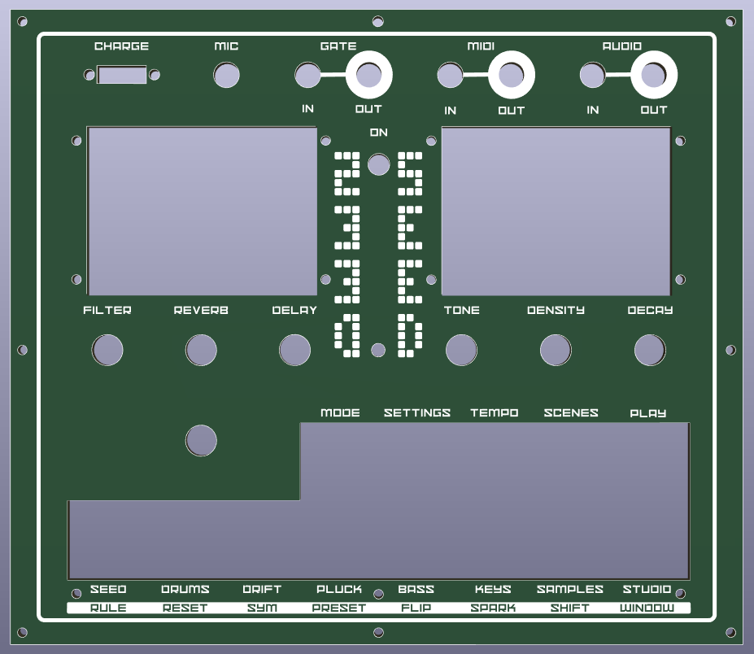
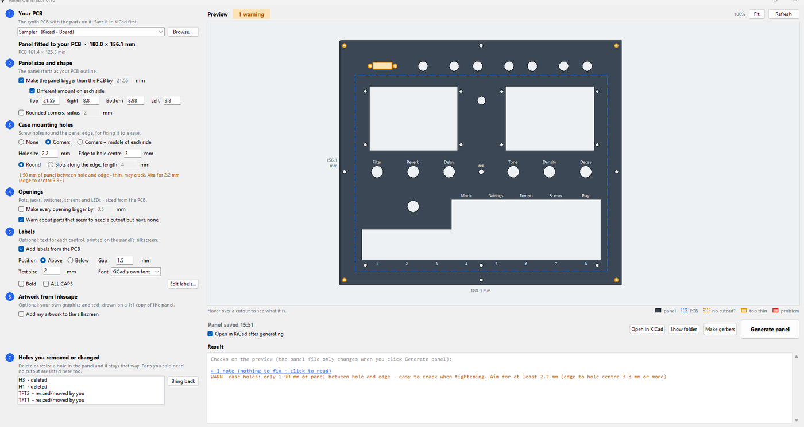
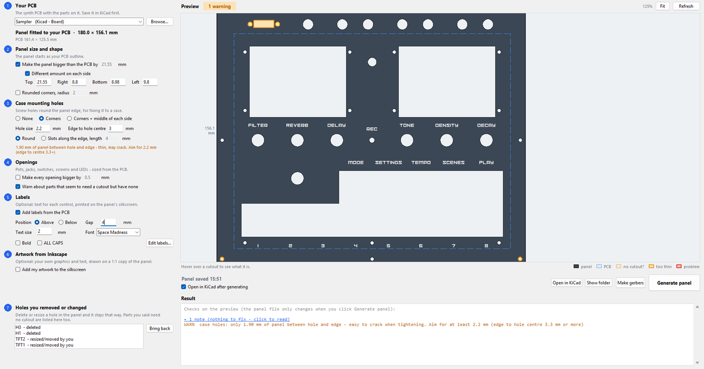
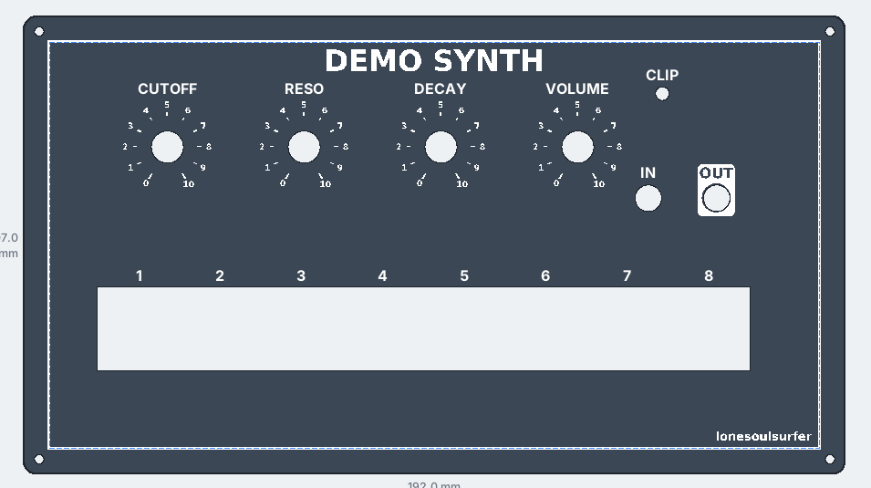
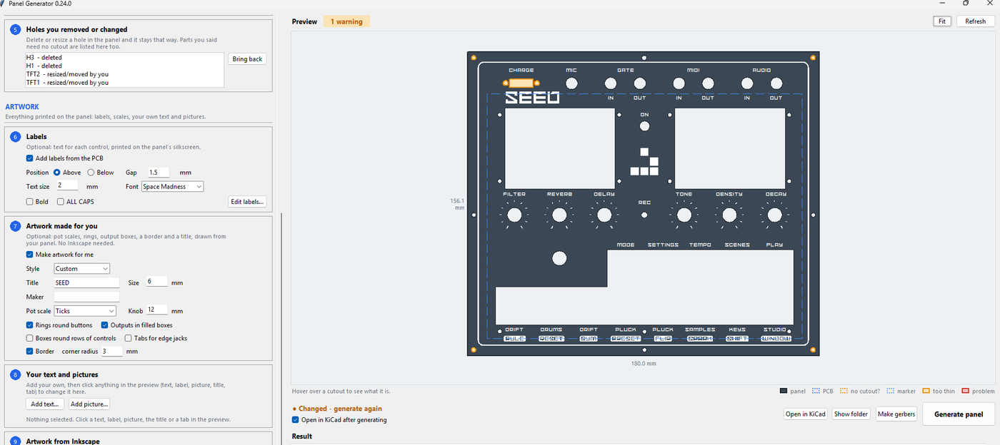
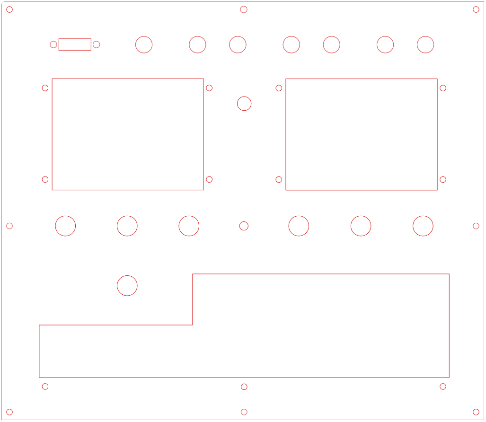
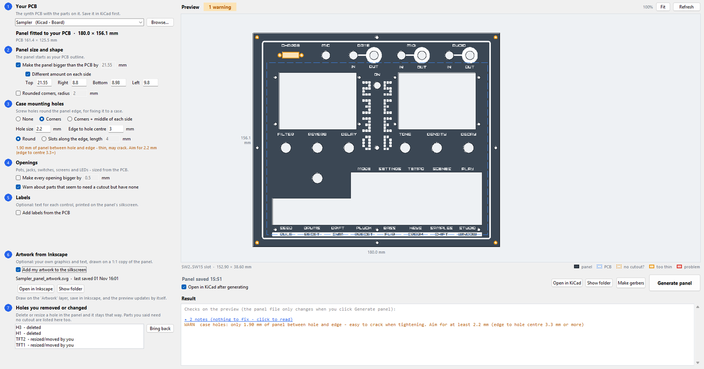
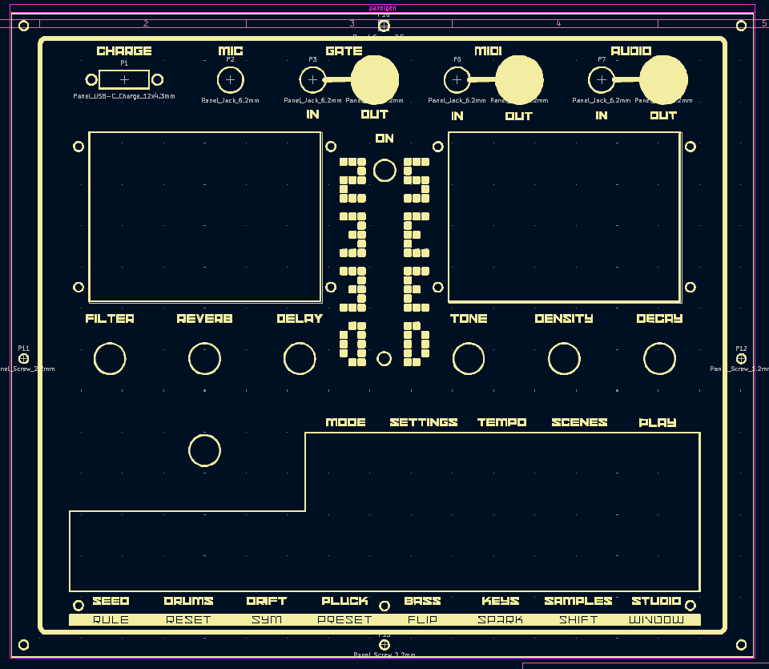
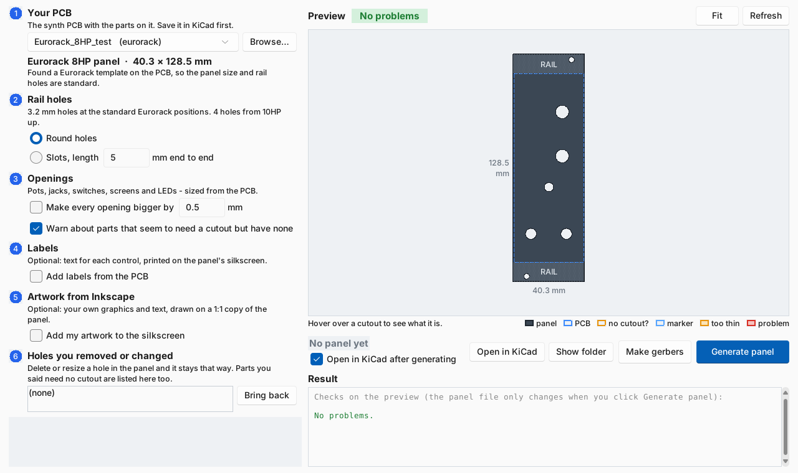

# KiCad Front Panel Generator

Turn your KiCad PCB into a matching front panel in one click.

Every pot, jack, switch, LED and screen on the board gets a hole in the right place and the right size. Add labels or your own Inkscape artwork, check it all in a live preview, and get gerbers ready to send to the fab. It does standard Eurorack panels (2-42HP) too.

You don't need to trace parts onto a User layer, export to Fusion or Inkscape and back, or redraw the panel by hand.

**▶ Watch the video: [Front Panel Design - Made Easy!](https://youtu.be/l9CzSfH8hN0)**

*The front panel for my Game of Life synth: holes, labels, pot scales, boxed key functions and the glider all made in Panel Generator, no Inkscape. Shown in KiCad's 3D viewer.*

## What you need

- **Windows** (to run from source on macOS or Linux, see the [technical guide](docs/TECHNICAL.md#run-from-source-windows-macos-linux))
- **KiCad 9 or 10**
- **[Inkscape](https://inkscape.org)** 1.2 or later, only if you want to add your own artwork

## Install

1. Download **`PanelGenerator-…-windows.zip`** from [Releases](../../releases) and unzip it anywhere.
2. Run **`PanelGenerator.exe`**. The first time, Windows may show *"Windows protected your PC"*. That's because the app isn't signed with a paid certificate. Click **More info → Run anyway**.
3. *(Optional)* In KiCad, add the two footprint libraries from the unzipped folder: **Preferences → Manage Footprint Libraries → Global Libraries → folder icon**. Add `PanelParts.pretty` (extra panel holes such as jacks and screws) and `Eurorack.pretty` (Eurorack templates).

## How to use it

### 1. Pick your PCB

Save your KiCad board, then open Panel Generator, click **Browse…** and choose the `.kicad_pcb` file you just saved. Once it's loaded, the preview shows a front panel the exact shape of your PCB, with holes cut out for all the parts that need them, such as pots, LEDs, audio sockets, switches and screens.

Panel Generator only reads the saved 'kicad_pcb' file, so save in KiCad again whenever you move a part. The preview updates by itself when you do. Boards you've used before are in the dropdown, so next time you can pick one from there instead of browsing.

### 2. Set the size, corners and case holes

The settings on the left are in two tabs: **Panel** (the board itself: size, shape and holes) and **Artwork** (everything printed on it). Each section has a heading you can click to fold it away, and the optional ones have a switch to turn them on.

By default the panel is the same size as your PCB. On the **Panel** tab:

- **Extra round the PCB**: makes the panel bigger on every side, good for when you are adding a case (tick *Set each side separately* to give each side its own amount).
- **Corner radius**: rounds the corners. 0 is square.
- **Case mounting holes**: screw holes to fix the panel to your case, in the corners or in the corners and the middle of each side. Set the hole size and how far its centre sits from the edge. The line underneath tells you how much panel is left between the hole and the edge. Pick **Slots** instead of round holes if you want some play to line the panel up.

Every change shows in the preview straight away. To give the preview more room, drag the bar between the settings and the preview, or the one above the buttons and the Result box. Use the **mouse wheel** to zoom in, **drag with the right mouse button** to move around, and **Fit** to see the whole panel again. Hover over any hole to see which part it's for and how big it is.

**Extra holes** are for things that aren't on the PCB, such as a jack or switch wired to the board, or a window:

- Pick a **hole size** from the list (or type your own), click **Hole**, then click the panel where it goes. **Rectangle** and **Slot** work the same way. You can also right-click the panel and add one there.
- It snaps into line with the other holes; where there's nothing to line up with, it lands on a whole half millimetre. Hold **Alt** to place it freely.
- Click it and its settings appear on the left: how far its middle is from the panel's **left edge** and **top edge**, and its size. For a round hole, pick a new **Hole size** from the list and it changes to that size. Type exact numbers there. Or drag one of its white corner squares to resize it; a rectangle shows its width and height as you drag.
- **Several at once:** drag a box round holes you added (or Shift-click them) to select them, then drag them together, **line them up** in a row or column, or type their **spacing**, middle to middle.
- **Copy** (Ctrl+D) repeats the selection with the same sizes and spacing. Two holes in a row become four, evenly spaced; drag the copy if it belongs somewhere else. **Delete** removes them.
- **Measure** (above the preview) is a ruler: click two points to see how far apart they are. It snaps to the middle and the edge of holes and to the panel edges. Hold **Ctrl** to keep the measurement dead level or straight up and down.
- **The ruler is a guide too.** After the first click, type a length (for example `16`) and press Enter: the other end lands exactly that far away. The ruler stays on the panel until you click **Clear ruler**, and anything you drag, add or paste snaps to its ends and its middle. So for two holes 16 mm apart with a slot between them: add a hole, measure 16 mm from its middle, paste a second hole on the far end, and drop the rectangle on the ruler's middle.

Extra holes are checked like every other hole (too close to an edge, overlapping a part), and stay where they are relative to the PCB if you later make the panel bigger.

The colours in the preview tell you what to check:

- **Orange outline:** a hole is very close to the panel edge or to another hole, so the panel there may be too thin.
- **Red outline:** a real problem, such as two holes overlapping.
- **Orange dashed box:** a part that looks like it might need a hole but doesn't have one. If it really doesn't (a tactile switch hidden behind the panel, say), click it in the preview and it won't be flagged again. If it does, see the [technical guide](docs/TECHNICAL.md) for how to add one.

The **Result** box under the preview lists anything that needs your attention.

### 3. Add labels (optional)

On the **Artwork** tab, open **Labels** and tick *A name next to each control*. Each pot, jack and switch gets a name printed next to its hole on the panel's silkscreen. The name comes from the PCB: a `Label` field if you've added one to the part, otherwise its Value (for example, a pot with the Value `Cutoff` is labelled CUTOFF).

- Choose whether labels go **above** or **below** the holes, and the **gap** between label and hole.
- Set the **text size** and **font**, and turn **bold** and **ALL CAPS** on or off.
- Click **Edit labels…** to see every label in a list, where you can change the text or remove any you don't want.

### 4. Let it make the artwork (optional)

Don't want to open Inkscape? The **Artwork** tab can draw the artwork from your panel. Pick a **Style** at the top to start from, then change anything in the sections below it (Title, Pots, Buttons, Jacks, Border):

- **Pot scales:** tick marks, 0–10 numbers or centre-zero (− 0 +) round each pot, over a 300° turn. Set the **Knob** size so the scale and the label start outside the knob.
- **Shapes round any hole:** under **Shapes**, set the shape (circle, box, triangle, hexagon or diamond), filled or outline, gap and line thickness. Then right-click a hole and choose *Add a shape round it*. Each new shape gets those settings, so a row of them is quick. To change a shape, click it: the same settings then change that shape. Click the shape to set its gap from the hole, line thickness and corners, or drag its edges to resize it. Pull a filled box over a label and the label is cut out of it. This works on every hole, including ones the automatic options below don't pick up.
- **Rings** round push buttons. Set how thick the ring is and how far it sits from the hole.
- **Vertical outputs in filled boxes:** any jack that comes up through the panel and whose label says OUT gets a solid box with the label cut out of it, the usual way modular panels show outputs. A text you add saying OUT right next to a jack counts too. So does a round hole you added under Extra holes with such a text next to it (a wired jack that isn't on the PCB).
- **Boxes round rows of controls:** tick *Box* under Pots, Buttons or Jacks for a box round 3 or more of them in a row or column, scales and labels inside. Drag its top, bottom or a side to resize it; the other side follows so it stays centred.
- **Horizontal jacks in tabs:** jacks lying flat at the panel edge (the plug goes in from the side) get a filled tab hanging from the edge with their labels cut out. Labels like MIDI IN and MIDI OUT become IN / OUT with MIDI underneath. Drag an edge of a tab or output box to make it bigger; it snaps to the edges of the others, so you can make them all the same size.
- **Border** (square, following the panel, or with its own rounded corners; set its **gap from the edge**, or leave 0 and it sits just inside the case holes) and a **title**, across the top, stacked down a side (letters one under another) or turned on its side (plus your name or brand, small, along the bottom). They go in the first free spot; drag them anywhere.

The styles are *None*, *Minimal*, *Classic synth* and *Modular*; change anything after and it becomes *Custom*. Once a panel looks the way you like, click **Save this look as my style**: every new PCB then starts with the same fonts, sizes, scales, rings and border, and *My style* appears in the Style list. To change one part (a centre-zero scale for a pan pot, or a jack that's an output but isn't labelled OUT), click its **Artwork** cell in **Edit labels**. Anything that would hit a hole, a label or the edge is left out, and you get a note.

You can use this and Inkscape together: the made artwork appears in the Inkscape file on its own layer, so you can draw more on top.

### 5. Add your own text, pictures and boxes (optional)

Everything here is done in the preview. Your own texts live under **Labels** on the left and pictures under **Pictures**. Untick *My own texts on the panel*, or switch Pictures off, to leave them off the panel (for example when you change to Inkscape artwork that has its own text) without losing them.

- **Move anything by dragging it:** a label, your text, a picture or the title. It snaps into line with the other labels, to the middle of holes (and of each key in a row of keys merged into one slot), half way between two holes (a MIDI label over its IN and OUT jacks), and to the middle of the gap between two things. Hold **Alt** to place it freely.
- **Click anything to change it.** Its settings appear on the left: text, size, put it back, hide or delete. To resize the title, a picture or one of your texts, click it and drag one of its white corner squares.
- **Add text** for things that aren't on the PCB, such as what each key does: under Labels → Your own, click **Text…** (or right-click the panel and choose *Add text here*), then click where it goes and type it.
- **Boxes round text:** for a key with two jobs, or a function that needs two keys pressed, click the text and set **Box** to *Line round it* or *Filled bar* (text cut out). Then drag the box's ends to stretch it over the keys. It snaps to the key labels and to other boxes. Stretch it over other texts and they go into the box too, where they are: one long bar under a row of keys. A box round just one text keeps it in the middle.
- **Lines:** under **Lines**, click **Line**, then click where it starts and where it ends (hold **Ctrl** to keep it dead level or straight up and down). Use them as dividers, brackets or signal-flow arrows. Click a line and **Thickness** changes it; you can also add an arrowhead or type its exact length, and drag an end to re-aim it. A line that ends at a hole runs right up to the hole's edge.
- **Pictures:** click **Picture…** and pick a PNG, JPG or SVG (a glider, a logo). Its dark parts print. Drag it into place, then click it to set its width, turn it, print its light parts instead, or delete it.
- **Several at once:** drag a box round them (or Shift-click each). Labels, texts, lines, pictures and holes you added can all be picked together, then dragged, copied or deleted as one. The **Delete** key removes what's selected; a PCB label is hidden instead, and Edit labels brings it back.
- **Copy and paste:** select a text, a picture or holes you added, press **Ctrl+C**, then **Ctrl+V** to paste a copy at the pointer (or right-click the panel and choose *Paste here*). Copying a label from the PCB pastes it as a text of your own.
- **Reset** (next to Undo) starts the panel again from your PCB: the same size as the PCB, with its holes and nothing else. That includes parts and cutouts you placed in the panel file in KiCad; the old panel file is kept as a backup (`…_panel.before-reset.kicad_pcb`) when you next generate. It asks first, and Undo brings it all back.
- **Undo** (or Ctrl+Z) takes back the last change, whether it's a setting on the left (panel size, labels, artwork options…) or something you did in the preview, up to 50 steps.

### 6. Draw your own artwork in Inkscape (optional)

Labels only do text. For anything else (borders, logos, boxes, white-on-black text, your own fonts), switch on **Artwork from Inkscape** and click **Create artwork file**.

This saves an Inkscape file in the `Front Panel` folder and opens it. The Inkscape page is an exact 1:1 copy of your panel, and every hole is drawn in red so you can see where things go. You can also line your designs up with the red holes using Inkscape's **Align and Distribute**.

- Draw on the **Artwork** layer. Don't move or resize the page.
- **Black** prints on the panel as silkscreen.
- **White** cuts out of black, so white text on a black bar comes out as text cut into the bar.
- **Save** in Inkscape. Panel Generator picks the file up automatically and the preview updates with your artwork. Change it and save again as often as you like.
- **Moved something on the PCB?** The red holes in the artwork file update by themselves when you save the PCB. Inkscape doesn't notice, so when Panel Generator says *Guides updated*, save your artwork in Inkscape and then use **File → Revert** to see the new positions.
- Draw on the **Artwork** layer, not the red one. Clicking a red hole to line something up can switch Inkscape to the red layer; anything you draw there is moved onto the top of your Artwork layer before the red holes are redrawn, and you'll get a note about it (File → Revert in Inkscape to see it there). To put one thing on top of another, use Home or Page Up, not a new layer.

The red holes aren't printed. They're redrawn from the PCB every time you generate, so they always match the board.

### 7. Generate the panel

When the preview looks right, click **Generate panel**. This makes the panel file (`<your board>_panel.kicad_pcb`) in a `Front Panel` folder next to your PCB, and opens it in KiCad so you can check it, including in the 3D viewer.

Your settings are saved with each board. If you change the PCB, the settings or the artwork later, the status line next to the buttons tells you the panel is out of date. Click **Generate panel** again to update it.

Close the panel in KiCad before you generate again, so the file can be replaced.

### 8. Make gerbers

Click **Make gerbers**. Panel Generator uses KiCad to make the gerber and drill files, checks the panel, and puts everything in one zip in the `Front Panel` folder. Upload that zip to JLCPCB, PCBWay or a similar fab.

Order it as a normal 1.6 mm PCB. Black solder mask with white silkscreen is the classic synth panel look.

## Eurorack

1. Start a new PCB in KiCad. Press **A**, search for the size you want from `Eurorack.pretty` (for example `Eurorack_8HP`), and place it at 0 degrees.
2. The template draws the PCB outline for you, plus the panel outline and the top and bottom rail areas, so you can see where parts can't go. Lay out your pots, jacks and LEDs inside the PCB outline.
3. Save, and open the PCB in Panel Generator. It finds the template and builds a standard 128.5 mm tall Eurorack panel of the right width for that HP, with the rail holes in the standard places (2 holes up to 9HP, 4 holes from 10HP up). You can make the rail holes slots instead.
4. If any part runs into a rail area, it's shown in red so you can move it before you order.

## Try it

[`examples/demo_synth`](examples/demo_synth) is a small synth board (4 pots, 2 jacks, an LED and 8 keys) made with KiCad's standard footprints. Open it in Panel Generator to try everything out before using your own board.

## Want more detail?

The **[technical guide](docs/TECHNICAL.md)** covers everything else: the command line, how cutout sizes are worked out (and how to add your own parts in `panel_rules.json`), custom cutouts drawn on User.1, panel-only parts, part markers, removing or resizing holes, and all the checks.

## Licence

MIT. See [LICENSE](LICENSE).
