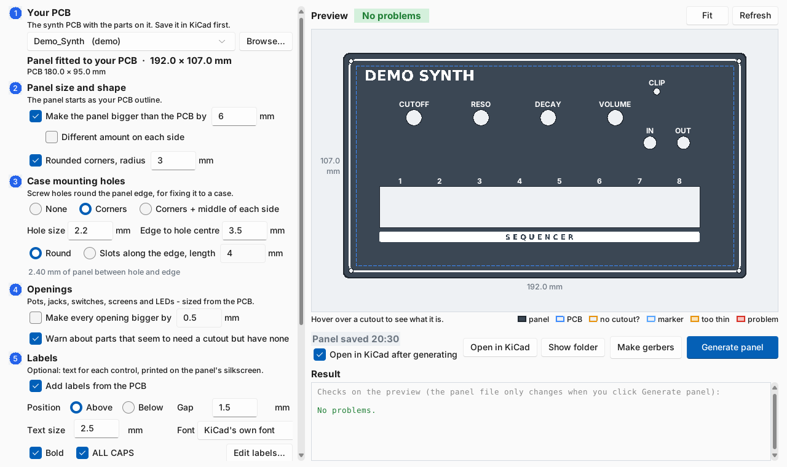
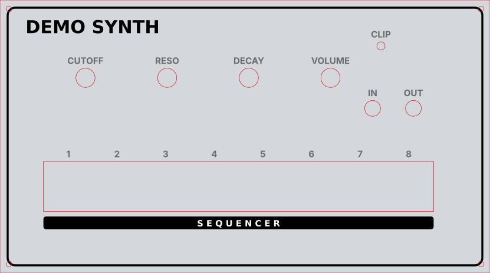

# KiCad Front Panel Generator

Turn your KiCad PCB into a matching front panel in one click.

Every pot, jack, switch, LED and screen on the board gets a hole in the right place and the right size. Add labels or your own Inkscape artwork, check it all in a live preview, and get gerbers ready to send to the fab. It does standard Eurorack panels (2-42HP) too.

You don't need to trace parts onto a User layer, export to Fusion or Inkscape and back, or redraw the panel by hand.

## What you need

- **Windows** (to run from source on macOS or Linux, see the [technical guide](docs/TECHNICAL.md#run-from-source-windows-macos-linux))
- **KiCad 9 or 10**
- **[Inkscape](https://inkscape.org)** 1.2 or later, only if you want to add your own artwork

## Install

1. Download **`PanelGenerator-…-windows.zip`** from [Releases](../../releases) and unzip it anywhere.
2. Run **`PanelGenerator.exe`**. The first time, Windows may show *"Windows protected your PC"*. That's because the app isn't signed with a paid certificate. Click **More info → Run anyway**.
3. *(Optional)* In KiCad, add the two footprint libraries from the unzipped folder: **Preferences → Manage Footprint Libraries → Global Libraries → folder icon**. Add `PanelParts.pretty` (extra panel holes such as jacks and screws) and `Eurorack.pretty` (Eurorack templates).

## How to use it

### 1. Pick your PCB

Save your board in KiCad, then click **Browse…** and choose its `.kicad_pcb`. The preview straight away shows a panel the shape of your PCB, with every hole already in place.

### 2. Set the size, corners and case holes

Make the panel bigger than the PCB, round the corners, and add screw holes to fix it to your case. Each change shows up in the preview as you make it. Use the mouse wheel to zoom, and hover over a hole to see what part it's for and its size.

The coloured outlines tell you what to look at:

- **Orange:** a hole is too close to the edge or to another hole.
- **Red:** a real problem.
- **Orange box:** a part that looks like it needs a hole but doesn't have one. If it really doesn't need one (a tactile switch behind the panel, say), click it in the preview and it won't be flagged again.

### 3. Add labels (optional)

Tick **Add labels from the PCB**. Each pot, jack and switch gets its name from the PCB (a `Label` field if you added one, otherwise the Value, e.g. `Cutoff`) above or below its hole. Choose the size, gap, font, bold and ALL CAPS. Click **Edit labels…** to change or remove any of them.

### 4. Add your own artwork (optional)

For borders, logos, boxes or white-on-black text, tick **Add my artwork to the silkscreen** and click **Create artwork file**. Inkscape opens with a 1:1 copy of your panel. The holes are drawn in red, so you can line things up with them.

Draw on the **Artwork** layer and save. **Black** prints on the panel. **White** cuts out of black. The preview updates by itself.

### 5. Generate the panel

Click **Generate panel**. This writes the panel into a `Front Panel` folder next to your PCB and opens it in KiCad. If you change the PCB or the artwork later, just generate again; the status line tells you when the panel is out of date.

### 6. Make gerbers

Click **Make gerbers**. You get a zip next to the panel, ready to upload to JLCPCB, PCBWay and similar fabs. Order it as a normal 1.6 mm PCB. A black mask with white silkscreen is the classic look.

## Eurorack

1. Start a new PCB and place a template from `Eurorack.pretty` (for example `Eurorack_8HP`) at 0 degrees.
2. Lay out your parts inside the PCB outline it gives you.
3. Open the PCB in Panel Generator. It sees the template and builds a standard 128.5 mm panel of the right width, with rail holes (4 from 10HP up). It also warns you if a part runs into a rail.

## Try it

[`examples/demo_synth`](examples/demo_synth) has the board in the screenshots above, made with KiCad's standard footprints. Open it in Panel Generator to try it out.

## Want more detail?

The **[technical guide](docs/TECHNICAL.md)** covers everything else: the command line, how cutout sizes are worked out (and how to add your own parts in `panel_rules.json`), custom cutouts drawn on User.1, panel-only parts, part markers, removing or resizing holes, and all the checks.

## Licence

MIT. See [LICENSE](LICENSE).
